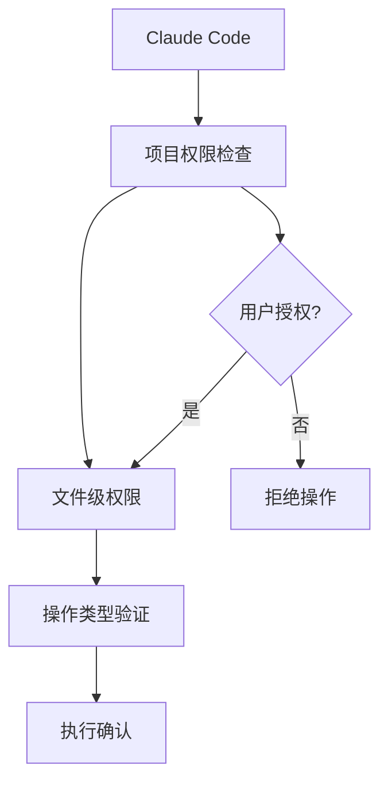

# 第一章 快速上手

> **建立 Claude Code 的基础认知框架**
> 理解核心概念，掌握基本操作，建立高效工作流程

## 📋 本章目录

- [学习目标](#学习目标)
- [核心概念](#核心概念)
  - [Claude Code 是什么](#claude-code-是什么)
  - [工作模式](#工作模式)
- [权限与安全](#权限与安全)
  - [安全架构](#安全架构)
  - [信任建立机制](#信任建立机制)
- [项目上下文配置](#项目上下文配置)
  - [CLAUDE.md 配置文件](#claudemd-配置文件)
  - [上下文管理策略](#上下文管理策略)
- [基础操作工作流](#基础操作工作流)
  - [文件操作模式](#文件操作模式)
  - [项目协作模式](#项目协作模式)
  - [调试与优化](#调试与优化)
- [最佳实践](#最佳实践)
  - [高效协作技巧](#高效协作技巧)
  - [常见应用场景](#常见应用场景)

---

## 🎯 学习目标

完成本章学习后，你将能够：

- ✅ **理解 Claude Code 的定位和价值**
- ✅ **掌握基本工作流程和操作模式**
- ✅ **配置项目上下文，建立安全协作环境**
- ✅ **建立高效的 AI 辅助开发习惯**

---

## 💡 核心概念

### Claude Code 是什么

**定义**：Claude Code 是 Anthropic 推出的 AI 编程助手，它不是一个独立的 IDE，而是一个**智能的编程伙伴**。

**核心理念**：
- **协作而非替代**：与现有工具链（VSCode、IntelliJ 等）协同工作
- **理解项目结构**：自动分析代码库，理解你的项目架构
- **安全可控**：严格的权限管理，明确的操作边界

**类比理解**：
```
传统工具链          Claude Code
文本编辑器    →     你的编程大脑
版本控制      →     项目记忆库
调试器        →     智能分析器
```

### 工作模式

#### 1. 文件操作模式
```bash
# 基本语法
claude edit <file_path> --指令

# 示例
claude edit src/main.js --添加错误处理逻辑
claude edit api.py --重构这个函数，提高可读性
```

#### 2. 项目协作模式
```bash
# 项目级操作
claude --help create new component
claude --help optimize database queries
claude --help review recent changes
```

#### 3. 对话交互模式
```bash
# 直接对话
claude
> 解释这段代码的逻辑
> 建议改进方案
> 帮我写测试用例
```

---

## 🔒 权限与安全

### 安全架构

Claude Code 采用**分层权限控制**，确保 AI 只能在授权范围内操作：



**权限层级**：
1. **全局权限**：是否允许 Claude Code 访问项目
2. **目录权限**：哪些目录可以访问
3. **文件权限**：哪些文件可以修改
4. **操作权限**：允许执行哪些类型的操作

### 信任建立机制

#### 首次协作流程
```bash
# 1. 项目扫描（可选）
claude scan
→ 扫描项目结构，建立代码索引

# 2. 信任配置
claude trust
→ 显示项目概览，确认授权范围

# 3. 建立协作关系
claude init
→ 创建 CLAUDE.md，设定协作规则
```

#### 权限配置示例
```yaml
# .claude/permissions.yml
allowed_directories:
  - src/
  - tests/
  - docs/

forbidden_operations:
  - delete_database
  - modify_config_files

confirmation_required:
  - file_deletion
  - major_refactoring
```

---

## 📁 项目上下文配置

### CLAUDE.md 配置文件

`CLAUDE.md` 是 Claude Code 理解项目的关键文件，相当于项目的"说明书"。

#### 基础模板
```markdown
# CLAUDE.md

## 项目概述
TypeScript + Express.js 后端服务，提供 RESTful API

## 核心架构
```
src/
├── controllers/    # 控制器层
├── services/       # 业务逻辑层
├── models/         # 数据模型
└── middleware/     # 中间件
```

## 技术栈
- Node.js 18+
- TypeScript 5.0
- Express.js 4.18
- MongoDB 6.0

## 常用命令
```bash
# 开发环境
npm run dev

# 运行测试
npm test

# 构建
npm run build

# 代码检查
npm run lint
```

## 代码规范
- 使用 ESLint + Prettier
- 函数必须有类型注解
- 测试覆盖率 > 80%
```

#### 高级配置示例
```markdown
# CLAUDE.md

## 项目概述
电商平台的订单处理系统，微服务架构

## 核心业务逻辑
1. **订单创建**：验证库存 → 计算价格 → 创建订单 → 发送通知
2. **支付处理**：调用支付网关 → 更新订单状态 → 触发发货
3. **库存管理**：预留库存 → 支付确认 → 扣减库存 → 释放预留

## 关键约束
- **性能要求**：订单处理延迟 < 200ms
- **数据一致性**：使用分布式事务确保订单和库存同步
- **错误处理**：所有外部调用必须有重试和降级机制

## 开发规范
- **命名规范**：使用 PascalCase 类名，camelCase 变量名
- **错误处理**：统一使用 Result 模式处理业务错误
- **日志规范**：关键操作必须记录审计日志

## 测试策略
- **单元测试**：覆盖所有业务逻辑
- **集成测试**：验证服务间交互
- **性能测试**：压力测试关键接口

## 部署环境
- **开发**：Docker Compose
- **测试**：Kubernetes
- **生产**：AWS ECS

## 重要提醒
- ⚠️ 修改价格计算逻辑必须经过 Code Review
- ⚠️ 数据库迁移必须向后兼容
- ⚠️ 第三方服务调用必须有熔断机制
```

### 上下文管理策略

#### 1. 文件优先级配置
```markdown
# CLAUDE.md 中的优先级说明

## 重要文件（高优先级）
- src/core/           # 核心业务逻辑
- src/services/       # 服务层
- src/controllers/    # 控制器层

## 次要文件（中优先级）
- src/utils/          # 工具函数
- tests/              # 测试文件
- docs/               # 文档

## 忽略文件（低优先级）
- node_modules/       # 依赖包
- dist/               # 构建输出
- *.log              # 日志文件
```

#### 2. 项目角色定义
```markdown
# CLAUDE.md 中的角色说明

## Claude Code 的角色
- **代码审查者**：检查代码质量，发现潜在问题
- **重构助手**：优化代码结构，提高可维护性
- **测试工程师**：生成测试用例，提高测试覆盖率
- **文档助手**：生成 API 文档，编写技术说明

## 不做的事情
- 不直接修改生产配置
- 不执行数据库迁移
- 不发布版本到生产环境
```

---

## 🛠️ 基础操作工作流

### 文件操作模式

#### 1. 代码修改
```bash
# 基础语法
claude edit <file_path> <instructions>

# 实例
claude edit src/userService.js \
  "添加用户注册的邮箱验证功能"

# 多文件操作
claude edit src/**/*.js \
  "将所有回调函数改为 async/await"
```

#### 2. 代码生成
```bash
# 创建新文件
claude create src/components/UserCard.tsx \
  "创建用户卡片组件，包含头像、姓名、邮箱"

# 生成测试文件
claude create tests/userService.test.js \
  "为 userService 生成完整的单元测试"
```

#### 3. 代码分析
```bash
# 解释代码
claude explain src/algorithms/quickSort.js

# 检查问题
claude check src/api/payment.js \
  "检查支付处理逻辑的安全性"
```

### 项目协作模式

#### 1. 需求分析
```bash
# 分析需求
claude analyze "需要实现用户认证功能"

# 输出建议：
# 1. 需要添加 JWT 验证中间件
# 2. 创建用户模型和数据库表
# 3. 实现注册/登录 API
# 4. 添加权限控制装饰器
```

#### 2. 架构设计
```bash
# 设计新功能
claude design "实现文件上传功能"

# 输出方案：
# - 前端：拖拽上传组件
# - 后端：multer 中间件处理上传
# - 存储：AWS S3 或本地文件系统
# - 数据库：文件信息表存储元数据
```

#### 3. 代码审查
```bash
# 审查最近修改
claude review

# 审查特定文件
claude review src/api/payment.js

# 输出格式：
# ✅ 优点：错误处理完善
# ⚠️  建议：添加参数验证
# 🐛  问题：存在潜在的 SQL 注入风险
```

### 调试与优化

#### 1. 性能分析
```bash
# 分析性能瓶颈
claude profile src/api/slowEndpoint.js

# 优化建议：
# - 添加数据库索引
# - 使用缓存减少查询
# - 优化算法复杂度
```

#### 2. 错误诊断
```bash
# 诊断运行时错误
claude debug error.log

# 分析异常堆栈，提供解决方案
```

---

## 📈 最佳实践

### 高效协作技巧

#### 1. 明确的指令设计
```bash
# ❌ 模糊指令
claude edit app.js "优化代码"

# ✅ 明确指令
claude edit app.js \
  "重构用户登录函数，添加以下功能：
  1. 密码强度验证
  2. 登录失败次数限制
  3. JWT token 生成
  4. 错误日志记录"
```

#### 2. 渐进式改进
```bash
# 第一步：基础功能
claude create auth.js "实现基础的用户认证"

# 第二步：增强功能
claude edit auth.js "添加角色权限控制"

# 第三步：性能优化
claude edit auth.js "添加 Redis 缓存会话"
```

#### 3. 验证和测试
```bash
# 每次修改后自动生成测试
claude edit utils.js "优化数据处理逻辑" \
  --auto-test

# 手动验证关键功能
claude test src/payment.js \
  "测试支付流程的各种边界情况"
```

### 常见应用场景

#### 1. 代码重构
```bash
# 提取公共逻辑
claude extract common.js \
  "从多个文件中提取相似的数据处理逻辑"

# 设计模式应用
claude refactor factory.js \
  "使用工厂模式重构对象创建逻辑"
```

#### 2. 功能开发
```bash
# 快速原型开发
claude prototype dashboard.js \
  "创建管理后台的基础框架"

# API 开发
claude create api/user.js \
  "实现用户相关的 REST API"
```

#### 3. 文档生成
```bash
# API 文档
claude docs src/api/ \
  "生成所有 API 接口的 Swagger 文档"

# 代码说明
claude explain README.md \
  "为项目添加详细的使用说明"
```

---

## 🎯 总结与下一步

### 本章要点回顾

1. **Claude Code 是智能编程伙伴**，不是 IDE 替代品
2. **权限安全是核心**，通过分层权限控制确保安全
3. **CLAUDE.md 是关键**，提供项目上下文信息
4. **明确指令是效率关键**，避免模糊不清的描述

### 实践建议

- **开始小规模协作**：先从简单的工具函数开始
- **建立信任关系**：逐步扩大 Claude Code 的操作权限
- **保持代码质量**：每次修改都要经过验证
- **定期更新上下文**：项目架构变化时及时更新 CLAUDE.md

### 下一章预告

**第二章：命令系统** - 深入了解斜杠命令、钩子事件和 MCP 集成

- 斜杠命令详解
- 钩子事件机制
- MCP 服务器集成
- 自定义命令开发

---

[第2章：命令系统 →]()